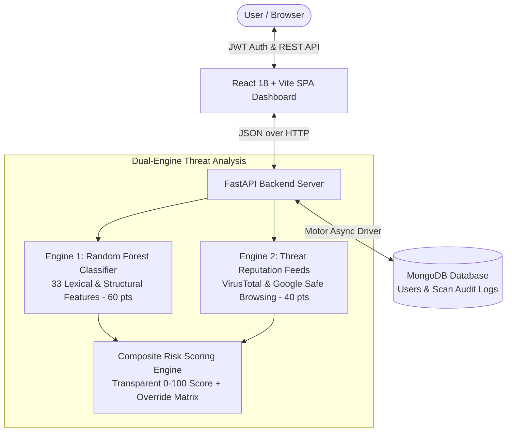

# PhishGuard — AI-Powered Phishing Detection System

PhishGuard is a high-performance cybersecurity application that detects, analyzes, and explains phishing threats across **URLs** and **email content**. Combining a 33-feature **Random Forest machine learning classifier** with real-time **threat reputation feeds (VirusTotal API v3 & Google Safe Browsing API v4)**, PhishGuard calculates a transparent, dual-engine risk score (0–100) and produces actionable, human-readable explanations.

---

## 1. Project Overview & 1-Minute Elevator Pitch

> **1-Minute Elevator Pitch:**
> *"PhishGuard is an AI-powered phishing detection platform engineered to identify credential harvesting and social engineering before users get compromised. Traditional phishing filters rely on static blacklists, which fail against zero-day phishing sites, brand-new disposable domains, and freshly launched campaigns. PhishGuard solves this by deploying a dual-engine architecture: a 33-feature Random Forest ML model evaluating structural and lexical signals (60 pts), and live external threat reputation feeds via VirusTotal and Google Safe Browsing (40 pts). The system computes a transparent 0-to-100 risk score, delivers immediate verdicts (Phishing, Suspicious, or Likely Legitimate), and provides transparent explanations. Backed by FastAPI, MongoDB, and React, PhishGuard ensures that both automated pipelines and security analysts understand exactly why a link or email is dangerous."*

---

## 2. High-Level Architecture & Component Interaction



### Component Interaction Flow:
1. **User Authentication**: Users register or log in. Passwords are salted and hashed using `bcrypt` (work factor 12). Duplicate registrations are rejected. On login, the system verifies email presence and hash matching, issuing a stateless signed **JWT Bearer Token** (HMAC-SHA256).
2. **Scan Ingestion**: The user submits a URL or email text via `/api/scan`. Rate limiting is enforced via `slowapi` (30 requests/minute per client IP).
3. **Dual-Engine Execution**:
   - **Engine 1 (Machine Learning - Random Forest)**: Extracts 33 lexical, structural, and character-entropy features and feeds them into the trained Random Forest classifier.
   - **Engine 2 (Threat Reputation Feeds)**: Asynchronously queries VirusTotal API v3 and Google Safe Browsing API v4. If unconfigured or timed out, the state is recorded as `UNKNOWN` (never assuming safety).
4. **Scoring & Explanations**: `scoring.py` consolidates the two engines into a transparent 0–100 risk score, applies high-confidence security override triggers, and returns explainable risk factors.
5. **Persistence**: Scan results, feature snapshots, component breakdowns, and timestamps are persisted to MongoDB for dashboard telemetry.

---

## 3. Technology Stack & Why Each Was Chosen

| Layer / Technology | Choice | Why Chosen Over Alternatives |
| --- | --- | --- |
| **Backend Framework** | **FastAPI (Python 3.12)** | Native asynchronous I/O (`asyncio`), automatic OpenAPI/Swagger documentation, strict type validation via Pydantic v2, and high performance. |
| **Machine Learning** | **Scikit-learn (Random Forest)** | Chosen over Deep Learning and basic Logistic Regression. Random Forest provides high accuracy, robust resistance to overfitting via bagging/feature randomization, fast inference (< 2ms), low memory footprint (< 1 MB model artifact), and feature importance explainability suitable for real-time audits. |
| **Database** | **MongoDB (Motor Async Driver)** | Security scan telemetry contains polymorphic, multi-signal nested JSON schemas. Document storage naturally accommodates semi-structured scan reports without heavy schema migrations. |
| **Authentication** | **JWT (jose) + Bcrypt** | Stateless JWT authentication decouples the frontend dashboard from backend memory, allowing horizontal scaling and cross-origin API utilization. Bcrypt provides secure, adaptive salted hashing. |
| **Frontend Framework** | **React 18 + Vite** | Vite offers instant Hot Module Replacement (HMR) and optimized rollup production bundles. React's component state model enables responsive explorer views, dynamic progress bars, and real-time updates. |
| **Styling** | **Custom Vanilla CSS Design System** | Tailored glassmorphism dark-mode cybersecurity theme (`#060b14` canvas, cyberpunk neon accents, responsive CSS grid, card micro-interactions) without dependency bloat or framework churn. |
| **HTTP Client** | **HTTPX (Async)** | Supports native `async/await`, HTTP/2, and granular per-request timeouts for threat intelligence feeds. |

---

## 4. Phishing Detection Engine & Dual-Engine Scoring (0–100)

PhishGuard calculates total risk across **two core security engines**:

$$\text{Risk Score} = \text{Engine}_{\text{ML}}\,(60\,\text{pts}) + \text{Engine}_{\text{Reputation}}\,(40\,\text{pts})$$

The raw sum is evaluated against high-confidence security overrides and clamped to $[0, 100]$.

### Engine Breakdown:

| Engine | Max Points | Signals & Heuristics Evaluated |
| --- | :---: | --- |
| **1. ML Classifier (Random Forest)** | **60 pts** | Random Forest model trained on 33 lexical/structural features: URL length, hostname length, hyphen/dot counts, digit ratio, character Shannon entropy, risky TLDs (`.xyz`, `.top`, `.click`), URL shorteners (`bit.ly`, `tinyurl.com`), IP hosts, custom ports, and suspicious keyword hits. Model output probability $P \in [0, 1]$ scales to $P \times 60$ points. |
| **2. Reputation Feeds** | **40 pts** | Threat intelligence feeds: **VirusTotal API v3** (URL-safe base64 canonical lookup) and **Google Safe Browsing v4** (threat matches for malware and social engineering). Detections contribute $25 + (\text{vendors} \times 5)$ up to 40 points. **Unavailable/unconfigured APIs are treated strictly as `UNKNOWN`, never automatically SAFE.** |

### Verdict Thresholds:
- **Phishing**: $\text{Risk Score} \ge 65$
- **Suspicious**: $35 \le \text{Risk Score} < 65$
- **Likely Legitimate**: $\text{Risk Score} < 35$ *(System displays mandatory safety limitation advisories; never claims 100% guaranteed safe).*

### High-Confidence Security Overrides:
- **Override A (Threat Intelligence Confirmation)**: External Threat Intelligence blacklists URL $\rightarrow \max(\text{score}, 85)$ ("Phishing").
- **Override B (High-Confidence ML Detection)**: Random Forest model identifies clear structural phishing patterns ($P_{ml} \ge 0.70$) $\rightarrow \max(\text{score}, \text{round}(P_{ml} \times 100))$ ("Phishing").
- **Moderate ML Suspicion**: $P_{ml} \ge 0.50 \rightarrow \max(\text{score}, 35)$ ("Suspicious").

---

## 5. Local Setup & Execution Guide

### Prerequisites:
- **Python**: 3.11 or 3.12 installed.
- **Node.js**: v20 or v22 with `npm`.
- **MongoDB**: MongoDB Community Server running locally on `localhost:27017`.

### Step 1: Clone and Configure Environment

```bash
cd "AI powered phishing detection"
cp .env.example .env
```

### Step 2: Setup and Start Backend

```bash
cd backend

# Create virtual environment
python -m venv .venv

# Activate virtual environment
# Windows PowerShell:
.\.venv\Scripts\Activate.ps1
# Linux / macOS:
# source .venv/bin/activate

# Install dependencies
pip install -r requirements.txt

# Train the Random Forest Model
python ml/train.py

# Start FastAPI development server
uvicorn app.main:app --reload --port 8000
```

*Backend API will be live at `http://localhost:8000` with interactive Swagger docs at `http://localhost:8000/docs`.*

### Step 3: Setup and Start Frontend

In a separate terminal:
```bash
cd frontend

# Install npm dependencies
npm install

# Start Vite React development server
npm run dev
```

*Open your browser and navigate to `http://localhost:5173`.*

---

## 6. Verification & Test Suite

Run backend test suite:
```bash
cd backend
pytest -v
```

30 tests covering:
- Random Forest feature extraction & model inference
- Threat Reputation Feeds (VirusTotal & Google Safe Browsing mock responses, timeouts, unconfigured handling)
- User authentication, duplicate prevention & bcrypt validation
- Composite risk scoring & explainability
